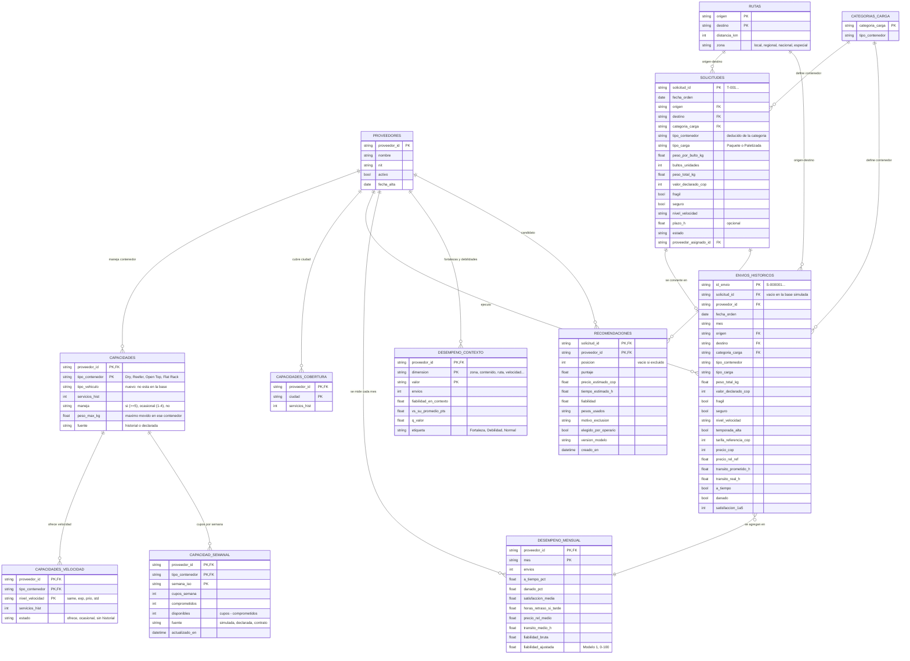

# Modelo de datos — recomendador de proveedores (COSCO SHIPPING, transporte terrestre Colombia)

Este documento recoge la revisión de la base, el catálogo de proveedores, el supuesto de capacidad, el modelo de datos y la lista de supuestos. Todo se puede reproducir con:

```bash
python modelo2_recomendador.py --entrenar   # entrena y escribe salidas_m2/
python verificar_catalogo.py                # 10 comprobaciones catálogo vs historial
python modelo2_recomendador.py --demo       # 9 solicitudes de prueba (T-001 a T-009)
```

---

## 1. Revisión de la base (`data/base_simulada_mensajeria.xlsx`, hoja `Envios`)

**Sí trae `tipo_contenedor` y `categoria_carga`.** Cada una de las 23 categorías corresponde a un único contenedor (relación 1 a 1, sin excepciones).

| Aspecto | Resultado |
|---|---|
| Tamaño | 31.386 envíos × 27 columnas, oct-2024 a sep-2026 (24 meses, 105 semanas) |
| Faltantes | 0 en todas las columnas. 0 filas duplicadas; `id_envio` único (S-000001 a S-031386) |
| Proveedores | Inter Rapidísimo 10.833 · Coordinadora 8.927 · Servientrega 5.159 · Grupo TCC 3.353 · Envía 2.313 · 4-72 801 |
| Contenedores | Dry 21.411 · Reefer 4.969 · Open Top 3.473 · Flat Rack 1.533 |
| Velocidades | std 23.422 · prio 5.375 · exp 2.455 · same 134 |
| Zonas | nacional 22.596 · local 5.423 · especial 2.486 · regional 881 |
| Ciudades / rutas | 15 ciudades, 225 rutas origen-destino (incluye la misma ciudad = zona local, 0 km) |
| Rangos | peso total 0,8–16.622 kg · distancia 0–1.457 km · precio 7.554–18,3 M COP · tránsito prometido 5,5–120 h · tránsito real 2,1–300 h · satisfacción 1–5 |
| Resultados | a tiempo 65 % · con daños 2,5 % · satisfacción media 3,69 |

**Lo que cuadra (verificado fila por fila):** `a_tiempo` = (tránsito real ≤ prometido); `precio_rel_ref` = precio / tarifa de referencia; `temporada_alta` = noviembre y diciembre; cada ruta tiene una sola zona y una sola distancia, simétrica en ambos sentidos; `mes` coincide con `fecha_orden`; la hoja `Panel_Proveedor_Mes` (144 filas) coincide exactamente con lo que se agrega de `Envios`.

**Inconsistencias y cosas a vigilar:**

1. **`Madera` y `Maderas` son dos categorías distintas** con nombre casi igual: `Madera` (658 envíos) va en Open Top, ~345 kg por bulto, casi siempre paletizada; `Maderas` (863) va en Dry, ~20 kg por bulto, paquete. Si el operario elige la equivocada, cambia el contenedor y por tanto los proveedores posibles. Propuesta: renombrar (p. ej. "Madera en bruto" y "Productos de madera").
2. **Peso por bulto redondeado:** en 2.522 envíos (8 %) `peso_por_bulto_kg × bultos` difiere de `peso_total_kg` en más de 0,15 kg (hasta 9 % en envíos pequeños). Es redondeo a 0,1 kg; la fuente de verdad es `peso_total_kg`.
3. **`tipo_carga` no se deduce bien del peso en Open Top.** La regla que usa el sistema cuando la solicitud no lo trae (Flat Rack o ≥ 150 kg por bulto ⇒ paletizada) acierta en el 95,4 % de los envíos, pero solo en el 64 % de los Open Top: ahí paquetes y estibas pesan lo mismo. Conviene pedir el dato en el formulario.
4. **Artefactos del simulador:** en Dry y Reefer toda carga paletizada pesa exactamente 150 kg por bulto; Flat Rack siempre es 1 bulto con tope de 6.000 kg; 4-72 nunca pasa de 50 kg. Son reglas del simulador, no del mercado.
5. **Velocidades raras:** mismo día solo existe en zona local (134 envíos, 0,4 %); exprés nunca en zona especial.
6. **Valores extremos (se conservan; los modelos trabajan en logaritmo):** 116 envíos con precio mayor a 4 veces la tarifa de referencia (máximo 11,3 veces) y 12 con tránsito real mayor a 3 veces el prometido (máximo 300 h).
7. **El tiempo prometido se explica al 100 % con las variables del envío** (R² = 1,00): es una tabla de tarifas y no aporta información sobre el proveedor más allá de eso.
8. **La hoja `Supuestos` trae los parámetros verdaderos del simulador.** Sirve para validar, pero el modelo no debe leerla (sería hacer trampa); el código actual no la usa.
9. **Faltan datos que sí existirían en la operación real:** tipo de vehículo, capacidad del proveedor, plazo pedido en los envíos históricos (`plazo_h` solo existe en las solicitudes) y tarifas pactadas por ruta.

---

## 2. Catálogo de proveedores (`salidas_m2/catalogo_proveedores.csv`)

Lo que atiende cada proveedor según el historial (número de envíos entre paréntesis). "Ofrece" quiere decir que lo ha hecho al menos 5 veces.

| Proveedor | Contenedores | Velocidades | Peso máximo movido | Sin cobertura |
|---|---|---|---|---|
| 4-72 | Dry (801) | exp, prio, std · mismo día ocasional (1) | Dry 50 kg | — |
| Coordinadora | Dry (5.586), Flat Rack (750), Open Top (1.050), Reefer (1.541) | todas, salvo Flat Rack mismo día (0) | Dry 2.006 · FR 6.000 · OT 16.622 · Reefer 1.050 kg | Quibdó |
| Envía | Dry (2.313) | todas | Dry 1.276 kg | Quibdó |
| Grupo TCC | Dry (2.083), Flat Rack (291), Open Top (402), Reefer (577) | todas en Dry; FR y OT sin mismo día (0); Reefer mismo día ocasional (3) | Dry 1.254 · FR 6.000 · OT 6.463 · Reefer 900 kg | Pasto, Quibdó |
| Inter Rapidísimo | Dry (7.436), Open Top (1.423), Reefer (1.974) | todas | Dry 1.998 · OT 8.385 · Reefer 1.200 kg | — |
| Servientrega | Dry (3.192), Flat Rack (492), Open Top (598), Reefer (877) | todas en Dry y Reefer; FR (2) y OT (3) mismo día ocasional | Dry 1.755 · FR 6.000 · OT 9.104 · Reefer 1.200 kg | — |

### Reglas que no cuadraban con el historial (corregidas en `modelo2_recomendador.py`)

| # | Regla anterior | Problema con los datos | Regla nueva |
|---|---|---|---|
| 1 | Velocidades por proveedor, sin mirar el contenedor | Aceptaba combinaciones que **nunca** ocurrieron: Flat Rack mismo día en Coordinadora y Grupo TCC, Open Top mismo día en Grupo TCC. También aceptaba combinaciones con 2 o 3 envíos en dos años. | Velocidad ofrecida **por proveedor y contenedor**, con el mismo umbral de 5 envíos |
| 2 | Peso máximo global del proveedor | Mezclaba contenedores: aceptaba un Reefer de 16.622 kg en Coordinadora (su máximo Reefer real es 1.050 kg, 15,8 veces menos) o de 6.463 kg en Grupo TCC (máximo real 900 kg). En total, 11 pares proveedor-contenedor aceptaban más peso del que habían movido. | Peso máximo **por proveedor y contenedor** |
| 3 | 4-72 aparecía sin mismo día, como si nunca lo hubiera hecho | Hay 1 envío mismo día de 4-72 | Se publica como "ocasional (1)": se sigue excluyendo, pero el catálogo ya no dice que nunca ocurrió |

`verificar_catalogo.py` recalcula todo desde `Envios` y comprueba 10 condiciones: contenedores, velocidades por contenedor, ninguna combinación permitida sin historial, peso por contenedor, ciudades, velocidad-zona, categoría-contenedor, conteos del CSV, repetición de los 31.386 envíos contra los filtros y coherencia con la capacidad. **Pasan las 10.** Al repetir el historial, el proveedor que hizo cada envío solo queda excluido en 9 envíos (0,03 %), todos en combinaciones publicadas como ocasionales.

Efecto en la demo: las 7 solicitudes originales mantienen el mismo ranking; solo cambian los textos de exclusión, que ahora traen el conteo que los respalda. Se agregaron dos casos de prueba para mostrar las reglas nuevas: **T-008** (Flat Rack mismo día: nadie cumple y se propone exprés) y **T-009** (Reefer de 1.050 kg: excluye a Grupo TCC, cuyo máximo Reefer es 900 kg).

---

## 3. Capacidad semanal (`salidas_m2/capacidad_semana.csv`) — SIMULADA

**Supuesto en una frase:** cada proveedor puede tomar por semana, en cada tipo de contenedor, un 15 % más de lo que movió en una semana alta pero no récord (el percentil 90 de sus semanas), y ya tiene comprometido entre el 55 % y el 95 % de esos cupos, al azar con semilla fija.

Comprobaciones: el volumen histórico superó esos cupos en solo 0 a 5 de las 105 semanas de cada par proveedor-contenedor, así que el supuesto es coherente con el historial. Las semanas incompletas del principio y del final no cambian el percentil 90. Hay que tener en cuenta tres cosas:

- **Coordinadora Reefer está llena a propósito** (23 de 23 comprometidos) para que la demo muestre qué pasa cuando el mejor proveedor no tiene cupo (T-002, T-009).
- La unidad es **envíos por semana**, no vehículos ni toneladas: un Flat Rack de 6 t y una caja de 2 kg ocupan un cupo cada uno.
- La tabla es una sola foto ("esta semana"); no hay historia de cupos.

**Cómo se alimentaría con datos reales:**

| Campo | Fuente real | Frecuencia |
|---|---|---|
| `cupos_semana` | Lo declara cada proveedor por tipo de vehículo o contenedor y regional (portal, plantilla o API), con el cupo mínimo del contrato marco como piso | Semanal, antes del lunes |
| `comprometidos` | Lo calcula COSCO: solicitudes propias asignadas al proveedor (asignada, confirmada o en tránsito) con cargue en esa semana, desde el TMS o ERP | En cada asignación |
| `disponibles` | `cupos − comprometidos` | Calculado |
| `fuente`, `actualizado_en` | "declarada", "contrato" o "estimada (p90 × 1,15)"; si el proveedor no reporta en 7 días se usa la estimada y el recomendador lo avisa | — |
| `rechazos_por_capacidad` | Solicitudes que el proveedor rechazó por falta de cupo (sirve para corregir cupos declarados demasiado optimistas) | Semanal |

---

## 4. Diagrama del modelo de datos

Las seis tablas pedidas (en mayúsculas sin prefijo) más cinco de apoyo: dos que detallan las capacidades, dos tablas de referencia y una de salida para guardar qué se recomendó.



Imagen del diagrama: `modelo_datos.png` (para presentaciones) y `modelo_datos.svg`.

### De dónde sale cada tabla hoy

| Tabla | Hoy (prototipo) | Con datos reales |
|---|---|---|
| PROVEEDORES | Nombres en `Envios` | Maestro de proveedores de COSCO |
| CAPACIDADES, _VELOCIDAD, _COBERTURA | Derivadas del historial (`catalogo_proveedores.csv`) | Declaradas por el proveedor y comparadas con el historial |
| CAPACIDAD_SEMANAL | Simulada (`capacidad_semana.csv`) | Ver sección 3 |
| SOLICITUDES | `data/solicitudes_prueba.csv` | Formulario del operario o TMS |
| ENVIOS_HISTORICOS | Hoja `Envios` | TMS, facturas y encuestas de satisfacción |
| DESEMPENO_MENSUAL | Hoja `Panel_Proveedor_Mes` y `salidas_m1/fiabilidad_mensual.csv` | Se recalcula cada mes desde ENVIOS_HISTORICOS |
| DESEMPENO_CONTEXTO | `salidas_m1/fiabilidad_contextos.csv` | Igual, recalculado por el Modelo 1 |
| RUTAS, CATEGORIAS_CARGA | Derivadas de `Envios` | Tablas maestras |
| RECOMENDACIONES | No se guarda | Registro de cada recomendación y de la decisión final, para auditar y reentrenar |

### Cobertura de los siete factores del reto

| Factor | Tablas y campos | Cómo lo usa el modelo |
|---|---|---|
| **Precio** | ENVIOS_HISTORICOS.`precio_cop`, `tarifa_referencia_cop`, `precio_rel_ref` · DESEMPENO_MENSUAL.`precio_rel_medio` · RECOMENDACIONES.`precio_estimado_cop` | Cotizador (gradient boosting) frente al precio de mercado → puntos de precio |
| **Tiempo** | ENVIOS_HISTORICOS.`transito_prometido_h`, `transito_real_h` · SOLICITUDES.`plazo_h`, `nivel_velocidad` · RUTAS.`distancia_km`, `zona` | Tiempo esperado frente al de mercado; la velocidad y un plazo ajustado suben su peso |
| **Vehículo** | CAPACIDADES.`tipo_contenedor`, `tipo_vehiculo`, `peso_max_kg` · CATEGORIAS_CARGA · CAPACIDADES_VELOCIDAD | Filtro duro: contenedor, peso y velocidad por contenedor |
| **Capacidad** | CAPACIDAD_SEMANAL.`cupos_semana`, `comprometidos`, `disponibles` | Filtro duro: sin cupos ⇒ excluido y propuesto como alternativa |
| **Desempeño** | DESEMPENO_MENSUAL.`fiabilidad_ajustada`, `danado_pct`, `satisfaccion_media` · ENVIOS_HISTORICOS.`danado`, `satisfaccion_1a5` | Puntaje de fiabilidad del Modelo 1 (0-100), con tendencia y confianza |
| **Puntualidad** | ENVIOS_HISTORICOS.`a_tiempo`, `transito_real_h` − `transito_prometido_h` · DESEMPENO_MENSUAL.`a_tiempo_pct`, `horas_retraso_si_tarde` | 60 % del puntaje de fiabilidad (40 % a tiempo + 20 % magnitud del retraso) y probabilidad de llegar a tiempo |
| **Fortalezas y debilidades** | DESEMPENO_CONTEXTO.`etiqueta`, `vs_su_promedio_pts`, `q_valor` | Ajuste por contexto en la fiabilidad y notas en los avisos |

---

## 5. Supuestos

**Datos**

1. La base es simulada (Monte Carlo con anclas reales). Sirve para probar el método; no permite sacar conclusiones sobre las empresas reales.
2. El historial (oct-2024 a sep-2026) representa la oferta actual: lo que un proveedor no ha hecho se considera que no lo ofrece.
3. `peso_total_kg` es la fuente de verdad del peso; `peso_por_bulto_kg` viene redondeado.
4. La categoría de carga determina el contenedor (relación 1 a 1 en la base). `Madera` y `Maderas` se tratan como categorías distintas.
5. Si la solicitud no trae `tipo_carga`, se deduce así: Flat Rack o ≥ 150 kg por bulto ⇒ paletizada. Acierta el 95,4 % en general y el 64 % en Open Top.
6. Si la solicitud no trae fragilidad, seguro o valor declarado, se asume no frágil, con seguro y valor de 1.000.000 COP. La temporada alta es noviembre y diciembre.
7. Los valores extremos de precio y tiempo son reales dentro de la simulación y se conservan.
8. La hoja `Supuestos` (parámetros verdaderos del simulador) no entra al modelo; solo sirve para validar.

**Catálogo (filtros duros)**

9. Un proveedor "ofrece" algo si lo ha hecho al menos 5 veces en el historial (`MIN_SERVICIOS = 5`). Entre 1 y 4 veces es "ocasional": se publica, pero no se recomienda.
10. Las velocidades se evalúan por proveedor y contenedor, no por separado.
11. El peso máximo es el mayor que el proveedor ha movido en ese contenedor, no su capacidad técnica declarada.
12. Un proveedor cubre una ciudad si la ha atendido como origen o como destino; no se exige que haya hecho esa ruta exacta (los proveedores pequeños no han recorrido todas las rutas por puro volumen).
13. Las combinaciones velocidad-zona posibles son las observadas en cualquier proveedor: mismo día solo en zona local, exprés nunca en zona especial.

**Capacidad**

14. Cupos semanales = percentil 90 del volumen semanal histórico × 1,15, por proveedor y contenedor, en envíos (no en vehículos ni toneladas).
15. Comprometidos = entre 55 % y 95 % de los cupos, al azar con semilla 2026. Coordinadora Reefer está llena a propósito para la demo.

**Puntaje y pesos**

16. El "mercado" es lo que costaría o tardaría un proveedor promedio en ese mismo envío (modelo sin la variable proveedor). Igual al mercado = 50 puntos; 20 % mejor = 70.
17. Pesos base del equipo por contenedor (precio / tiempo / fiabilidad): Dry 45/20/35, Reefer 10/40/50, Open Top 35/10/55, Flat Rack 25/5/70.
18. El tiempo gana peso con la velocidad pedida (prio +10, exp +20, mismo día +25 puntos) y con un plazo ajustado (+15 si plazo / tiempo de mercado < 1,25); después se renormaliza a 100 %.
19. La fiabilidad del Modelo 1 combina puntualidad 40 %, magnitud del retraso 20 %, envío sin daños 25 % y satisfacción 15 %, ajustada por dificultad del envío, con corrección por pocos datos y más peso para los envíos recientes.
20. Una fortaleza o debilidad solo se declara si la diferencia es de al menos 2 puntos y pasa la prueba de Benjamini-Hochberg con q ≤ 0,10.
21. Avisos: empate técnico si la diferencia es menor a 2 puntos; concentración si un proveedor tiene más del 35 % de los envíos de las últimas 4 semanas.
22. La inflación se captura con una tendencia mensual en el cotizador (meses desde oct-2024).
23. La probabilidad de llegar dentro del plazo supone que el error del tiempo real es log-normal y con la misma dispersión para todos los envíos (σ = 0,35 en logaritmo). En abr-sep 2026 la dispersión fue parecida por velocidad y zona, y lo predicho difirió de lo observado en 1 a 3 puntos. Por debajo del 70 % se avisa; no excluye ni cambia el puntaje.
24. En la asignación por lotes, los cupos de `capacidad_semana.csv` son los disponibles para todo el lote, sea cual sea la fecha de las solicitudes. El tope del 35 % es la parte entera de 0,35 × tamaño del lote y no se aplica con 1 o 2 solicitudes. Una solicitud solo queda sin asignar si ninguna combinación respeta las dos reglas.
